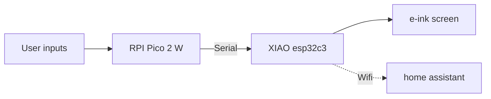

  ### bedroom dashboard
  A **"macropad"** to control **everythings** connected in my bedroom throught *home assistant*.

---------------
### features
- control **lights,leds,sockets** trought home assistant
- visual feedbacks : 3 leds and a rgb leds
- buzzer feedback
- on **battery** : 3.7V/1000mAh
- **e-ink** screen black and red (the worst buy ever because it takes almost 12s to refresh)
- control **chip remotly controlled sockets** by hacking the remote with optocouplers
- (planned) control **webradio** and API call to self-hosted *azuracast* to switch current music

### how it works
hardare :
