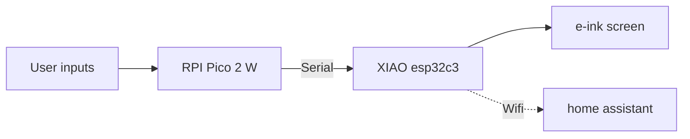

  ### bedroom dashboard 🛜️
  A **"macropad"** to control **everythings** connected in my bedroom throught *home assistant*.

---------------
### ✅️ features 
- control **lights,leds,sockets** trought home assistant
- visual feedbacks : 3 leds and a rgb leds
- buzzer feedback
- on **battery** : 3.7V/1000mAh
- **e-ink** screen black and red (the worst buy ever because it takes almost 12s to refresh)
- control **chip remotly controlled sockets** by hacking the remote with optocouplers
- (planned) control **webradio** and API call to self-hosted *azuracast* to switch current music

### 📜️ how it works
hardware :

software :
> [!IMPORTANT]
> I use Ai to write [main.cpp](https://github.com/t0qen/bedroom-dashboard/blob/main/xiao/src/main.cpp)

### 📷️ screenshots

### models
https://cad.onshape.com/documents/ad628567f996aec9f7dfa373/w/c9bc160ac345cb43137849e8/e/b2123f6f02230e54762eaeb9?renderMode=0&uiState=6adfa595d9f9c3bd8f9fb129