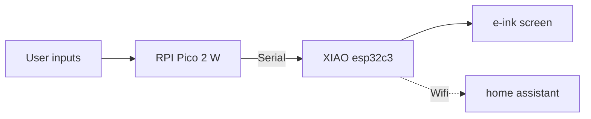
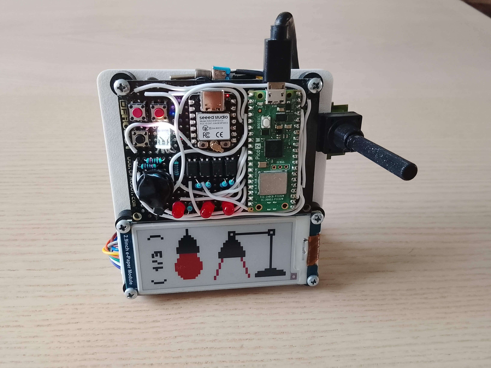
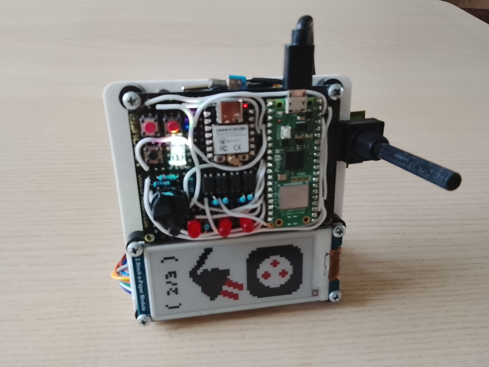
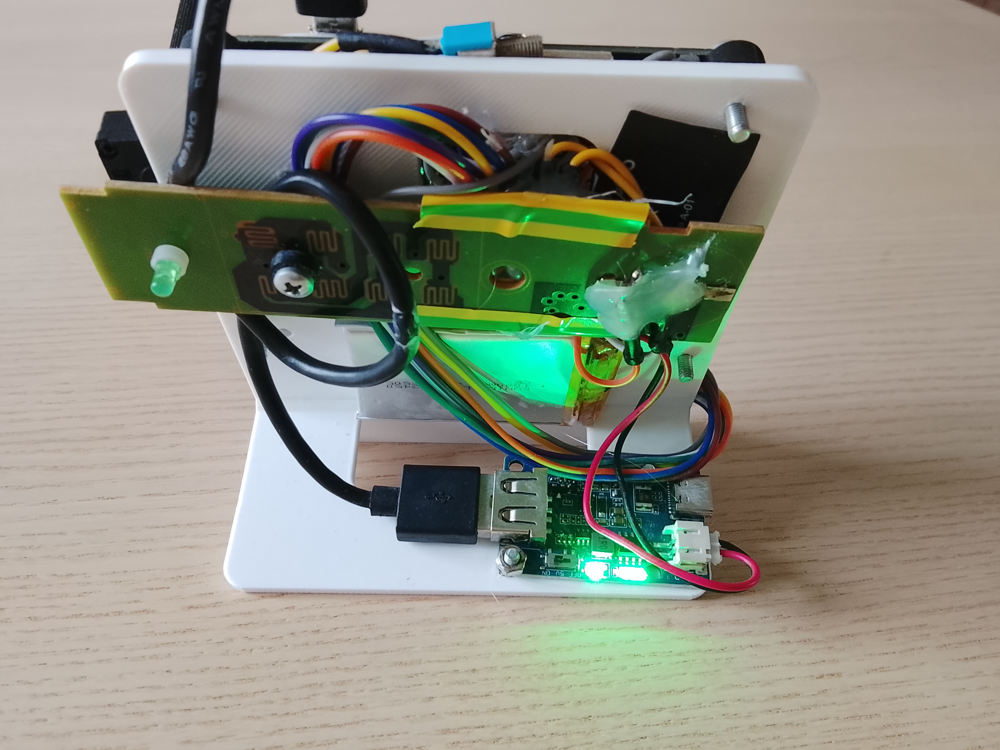

  ### bedroom dashboard 🛜️
  A **"macropad"** to control **everythings** connected in my bedroom throught *home assistant*.

  [features](#features) - [how it works](#hiw) - [screenshots](#screenshots) - [production](#production) - [about](#about) 

---------------

### ✅️ features 
- control **lights,leds,sockets** trought home assistant
- visual feedbacks : 3 leds and a rgb leds
- buzzer feedback
- on **battery** : 3.7V/1000mAh
- **e-ink** screen black and red (the worst buy ever because it takes almost 12s to refresh)
- control **chip remotly controlled sockets** by hacking the remote with optocouplers
- (planned) control **webradio** and API call to self-hosted *azuracast* to switch current music

### 📜️ how it works 
hardware :

software :
> [!IMPORTANT]
> I use Ai to write [main.cpp](https://github.com/t0qen/bedroom-dashboard/blob/main/xiao/src/main.cpp)

### 📷️ screenshots 

### 📦️ production 
- [models](https://github.com/t0qen/bedroom-dashboard/tree/main/production/models), or visit [onshape](https://cad.onshape.com/documents/ad628567f996aec9f7dfa373/w/c9bc160ac345cb43137849e8/e/b2123f6f02230e54762eaeb9?renderMode=0&uiState=6adfa595d9f9c3bd8f9fb129) directly

- [bom](https://github.com/t0qen/bedroom-dashboard/blob/main/production/BOM.md) which contains all the components of the project

### ✏️ about 
**Why make this ?**
Because almost everythings is conencted in bedroom, and having to unlock my phone everytime to do things as easy as switch a socket was exhausting. I wanted a easy, fast and reliable solution.